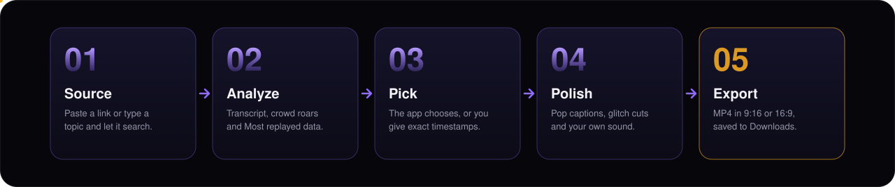
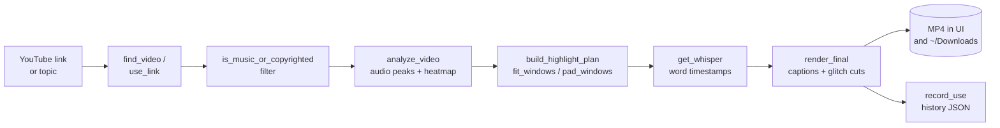

<div align="center">



<br>

<a href="#-quick-start"></a>
<a href="https://www.gradio.app"></a>
<a href="https://github.com/yt-dlp/yt-dlp"></a>
<a href="https://github.com/SYSTRAN/faster-whisper"></a>
<a href="LICENSE"></a>

<br><br>

**Turn any YouTube video into a captioned, share-ready short.**<br>
Paste a link or type a topic. Wanna Clip finds the best moments, cuts them, adds word-by-word captions, and hands you an MP4.

<sub>100% local &nbsp;·&nbsp; CPU-only &nbsp;·&nbsp; No API keys &nbsp;·&nbsp; No FFmpeg install</sub>

<br>

[Demo](#-demo) · [Features](#-features) · [How it works](#-how-it-works) · [Quick start](#-quick-start) · [Usage](#-usage) · [Configuration](#-configuration) · [Architecture](#-architecture) · [Troubleshooting](#-troubleshooting)

</div>


## 🎥 Demo

<div align="center">


https://github.com/user-attachments/assets/88f49f47-c573-4dca-aa3f-60d93a2cbb9c


</div>


## ✨ Features

<table>
  <tr>
    <td width="33%" valign="top">
      <h4>🔎 Finds the video for you</h4>
      Type a topic and it searches for a popular video from the last two years. It skips music, copyrighted uploads, livestreams and other people's reaction videos.
    </td>
    <td width="33%" valign="top">
      <h4>🎯 Picks the best moments</h4>
      Uses YouTube's <b>Most replayed</b> data when available, and falls back to the loudest, most exciting parts of the audio.
    </td>
    <td width="33%" valign="top">
      <h4>⏱️ Exact timestamps</h4>
      Know the moment you want? Enter <code>12:12-15:09, 16:00-16:54</code> and it cuts and joins those ranges, skipping auto-detection.
    </td>
  </tr>
  <tr>
    <td valign="top">
      <h4>💬 Captions that pop</h4>
      Word-level captions generated locally with Whisper, animated as each word is spoken.
    </td>
    <td valign="top">
      <h4>⚡ Glitch transitions</h4>
      Multi-moment clips are stitched with glitch cuts. Add your own transition sound if you like.
    </td>
    <td valign="top">
      <h4>⚽ Football goal mode</h4>
      Detects goals from commentary, crowd roars and referee whistles, and tells them apart from fouls.
    </td>
  </tr>
  <tr>
    <td valign="top">
      <h4>📱 Short or widescreen</h4>
      Export vertical <b>1080×1920</b> (up to 3 min) or horizontal <b>1920×1080</b> (up to 10 min).
    </td>
    <td valign="top">
      <h4>🔁 Never repeats itself</h4>
      Remembers which moments of a video it already used, so running it again gives you fresh ones.
    </td>
    <td valign="top">
      <h4>🖥️ Runs on your machine</h4>
      CPU-only, no GPU, no API keys, and no separate FFmpeg install. Your videos never leave your computer.
    </td>
  </tr>
</table>


## 🧭 How it works



| Stage | What happens |
| --- | --- |
| **1. Source** | You give it a YouTube link, or a topic to search for. Music, copyrighted uploads and livestreams are filtered out. |
| **2. Analyze** | It listens to the whole video with a fast Whisper model, looks for audio peaks, and reads YouTube's *Most replayed* data when the video has it. |
| **3. Pick** | It chooses the strongest moments, or uses the timestamps you typed. |
| **4. Polish** | It renders the clip with word-by-word captions, optional glitch transitions and your own sound. |
| **5. Export** | You get an MP4 in the interface, and a copy is saved to your `Downloads` folder. |


## 🚀 Quick start

**Requirements:** Python 3.10 or newer, and about 1 GB of free disk space for the speech models, which download on first run.

```bash
# 1. Get the code
git clone https://github.com/rhythm162k/Wanna-Clip.git
cd Wanna-Clip

# 2. Create an isolated environment
python3 -m venv .venv
source .venv/bin/activate          # Windows: .venv\Scripts\activate

# 3. Install dependencies
pip install -r requirements.txt

# 4. Launch
python app.py
```

Your browser opens at **http://127.0.0.1:7860**. FFmpeg is bundled through `imageio-ffmpeg`, so there is nothing else to install.

> [!NOTE]
> The first clip is slower than the rest because the Whisper models (about 460 MB for captions, plus a small one for analysis) are downloaded once and then cached.

> [!TIP]
> YouTube changes often. If downloads start failing, update the downloader: `pip install -U yt-dlp`.

<details>
<summary><b>What gets installed</b></summary>

<br>

| Package | Purpose |
| --- | --- |
| `gradio>=4.0` | Web interface and local server |
| `yt-dlp` | Video search, metadata and downloading |
| `faster-whisper` | Fast CPU speech-to-text with word-level timestamps |
| `imageio-ffmpeg` | Bundled FFmpeg binary for audio and video processing |
| `numpy` | Audio peak analysis |
| `Pillow>=10.1` | Drawing the pop captions |

</details>


## 🎬 Usage

1. **Pick your video.** Paste a YouTube link, or type a topic.
2. **Choose a format.** Short (vertical) or Regular video (horizontal).
3. **Pick the moments.** Make one clip, or join multiple moments. Optionally enter exact timestamps.
4. **Add the polish.** Switch glitch transitions and pop captions on or off, and optionally add a transition sound.
5. **Make clip.** Watch progress in the status box. The result appears below and is saved to `~/Downloads`.

### Formats

| Format | Resolution | Max length |
| --- | --- | --- |
| **Short** (vertical, 9:16) | 1080×1920 | 3 minutes |
| **Regular video** (horizontal, 16:9) | 1920×1080 | 10 minutes |

### Clip types

| Option | What you get |
| --- | --- |
| **One clip** | The single best moment, using *Most replayed* data when available, otherwise the loudest part of the audio. |
| **Multiple moments joined** | Several strong moments joined with transitions. Choose *Auto-detect*, *Football goals (one match)* or *Best moments (one topic)* under **What to cut**. |

### Exact timestamps (optional)

Leave the box empty and the app chooses for you. Fill it in and the app uses exactly what you typed.

| You type | What happens |
| --- | --- |
| `12:12` | One clip starting at 12:12 and running for the **Length** you set |
| `12:12-15:09` | One clip from 12:12 to 15:09 |
| `12:12-15:09, 16:00-16:54` | Both ranges cut and joined, in the order you typed them |
| `12:12-15:09, 20:30` | Mix ranges and single points freely |

Hours work too (`1:02:03`), and so does `12:12 to 15:09`. The total must fit the format limit (3 minutes for Short, 10 for Regular). If it doesn't, the app tells you instead of silently trimming your ranges.

### Search options

Under **Search options** you can set a minimum view count (default 100,000), restrict results to Creative Commons videos, and name a channel whose own reaction content should be allowed.

### Where files go

| What | Where |
| --- | --- |
| Finished clips | Shown in the app and copied to `~/Downloads` |
| Usage history (for "Recent") | `~/ViralClips/used_videos_v4.json` |
| Temporary working files | Your system temp folder, cleaned up automatically |


## ⚙️ Configuration

Everything lives in `app.py`. These are the settings people most often change:

| Setting | Default | What it does |
| --- | --- | --- |
| `get_whisper()` model | `"small"` | Caption accuracy. Try `"base"` for speed or `"medium"` for accuracy. |
| `ANALYSIS_MODEL` | `"tiny"` | The fast model used to find moments. `"base"` is slower but more accurate. |
| `MAX_AGE_DAYS` | `730` | How far back topic search looks for videos. |
| `RESET_DAYS` | `183` | How often the "already used" history is wiped (about 6 months). |
| `FORMATS` | Short / Regular | Output size, caption size and position, and maximum length. |
| `FONT_PATHS` | macOS, Windows, Linux | Fonts tried for captions, in order. |
| `OUT_DIR` | `~/ViralClips` | Where history is stored. |

Videos are downloaded at up to 720p to keep things fast, then rendered to the output size.


## 🏗️ Architecture

Wanna Clip is a single-file app. `app.py` handles everything from search to rendering, and the interface is built with Gradio Blocks.



<details>
<summary><b>Code map for contributors</b></summary>

<br>

| Area | Key symbols in `app.py` | Notes |
| --- | --- | --- |
| **Discovery** | `find_video`, `use_link`, `is_music_or_copyrighted`, `MUSIC_WORDS`, `COPYRIGHT_WORDS` | Searches recent popular videos, filters music, copyrighted uploads and livestreams. Only the needed time spans are downloaded. |
| **Analysis** | `analyze_video`, `CHUNK_SECONDS` | Splits audio into chunks and scores RMS energy, whistles and crowd roars. |
| **Selection** | `build_highlight_plan`, `fit_windows`, `pad_windows` | Picks non-overlapping moments, fits them to the length limit and pads the cut points. Typed timestamps bypass this step. |
| **Transcription** | `get_whisper`, `ANALYSIS_MODEL` | Lazy, cached `faster-whisper` models on CPU with `int8` quantization. |
| **Rendering** | `render_final`, `caption_strip`, `glitch_frame`, `FORMATS` | Pillow draws the pop captions, glitch cuts join moments, FFmpeg encodes the result. |
| **History** | `load_history`, `record_use`, `recent_videos` | JSON state in `~/ViralClips/used_videos_v4.json`, wiped every `RESET_DAYS` days. |
| **Interface** | `gr.Blocks`, `CP_CSS`, `CP_JS` | Custom styling and event wiring on top of Gradio. |

</details>

<details>
<summary><b>History file format</b></summary>

<br>

Each video the app has used is stored by its YouTube ID, along with the start times (in seconds) of the moments already clipped:

```json
{
  "_last_reset": "2026-01-01",
  "VIDEO_ID": {
    "title": "Video title",
    "url": "https://www.youtube.com/watch?v=VIDEO_ID",
    "channel": "Channel name",
    "moments": [42, 120],
    "last_used": "2026-01-15T14:32:00"
  }
}
```

</details>


## 🛠️ Troubleshooting

<details>
<summary><b>Downloads fail, or I get HTTP 403 / sign-in errors</b></summary>

Update the downloader, since YouTube changes frequently:

```bash
pip install -U yt-dlp
```
</details>

<details>
<summary><b>The first run is very slow or looks stuck</b></summary>

The speech models download once on first use. After that they are cached and runs are much faster. Long videos take longer because the whole video is analyzed.
</details>

<details>
<summary><b>Captions look tiny or use the wrong font</b></summary>

The app looks for bold system fonts in `FONT_PATHS`. If none exist on your system, it falls back to a basic built-in font. Add the path to any bold `.ttf` file to that list.
</details>

<details>
<summary><b>I want a video's moments to be picked fresh again</b></summary>

The app remembers moments it has used so repeats give new ones. To reset everything, delete `~/ViralClips/used_videos_v4.json`. It also resets itself automatically about every six months.
</details>

<details>
<summary><b>My typed timestamps were rejected</b></summary>

The total length of all ranges must fit the format limit (3 minutes for Short, 10 for Regular). Shorten the ranges or switch to Regular video.
</details>

<details>
<summary><b>The page looks unstyled or animations are missing</b></summary>

The interface styling uses features of recent Gradio versions. Update with `pip install -U gradio`, then hard-refresh the page.
</details>


## 📁 Project structure

```
Wanna-Clip/
├── app.py              # the whole app: search, analysis, rendering, interface
├── requirements.txt    # Python dependencies
├── favicon.png         # browser tab icon
├── assets/             # README graphics (banner, divider, footer, how-it-works)
├── LICENSE
└── README.md
```

## 🤝 Contributing

Issues and pull requests are welcome. For bigger changes, open an issue first so we can talk it through.

1. Fork the repo and create a branch: `git checkout -b my-feature`
2. Make your change and test it by running `python app.py`
3. Open a pull request describing what changed and why

## 🧱 Built with

[Gradio](https://www.gradio.app) for the interface · [yt-dlp](https://github.com/yt-dlp/yt-dlp) for downloading · [faster-whisper](https://github.com/SYSTRAN/faster-whisper) for transcription · [FFmpeg](https://ffmpeg.org) via [imageio-ffmpeg](https://github.com/imageio/imageio-ffmpeg) for video · [Pillow](https://python-pillow.org) and [NumPy](https://numpy.org) for captions and effects.

## ⚖️ Responsible use

This tool makes it easy to cut other people's videos. Only clip content you own, have permission to use, or that is licensed for reuse (the **Creative Commons only** option helps here). You are responsible for following YouTube's Terms of Service and the copyright rules where you live.

## 📄 License

Released under the [MIT License](LICENSE).

<br>

<div align="center">
  
  <br><br>
  Built by <b>Md. Sami-El Bashar Rhythm</b><br>
  <sub>If this saved you time, a ⭐ on the repo is much appreciated.</sub>
</div>
